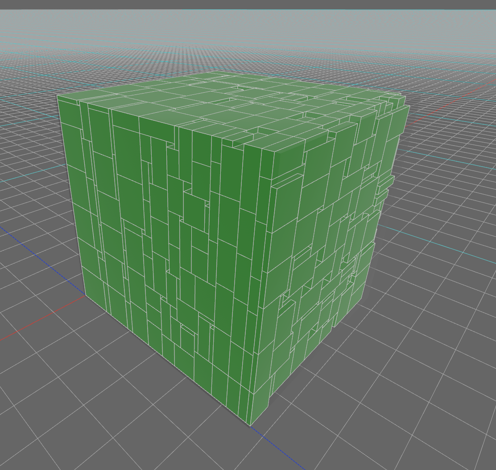

# packer-3d

A Rust crate for 3D container packing: place axis-aligned boxes into a container without overlap, minimizing any combination of the container's width, height and length. Published on crates.io as [`packer-3d`](https://crates.io/crates/packer-3d).

It extends the hole-based heuristic from my [2D strip packing solver](https://github.com/R-Besson/strip-packing-cpp-rewritten) to three dimensions. The repository also includes a Python generator that produces the hole-splitting code for any number of dimensions (see [N-dimensional generalization](#n-dimensional-generalization)).



*Example packing, rendered with the [Bevy](https://crates.io/crates/bevy) game engine.*

## How it works

Instead of tracking the boxes already placed, the packer tracks the **empty space** that is left, as a set of axis-aligned "holes".

1. The container starts as a single hole. Along every axis you ask to minimize, that hole is unbounded.
2. Boxes are sorted by a heuristic you choose, such as descending volume.
3. Each box (and, if rotations are enabled, each of its orientations) is placed into the best hole that fits it.
4. Every hole that the placed box intersects is split into the smaller boxes that remain once the box is subtracted from it (a constructive solid geometry subtraction). Along each axis, the box can relate to a hole in 4 ways, so in 3D there are 4³ = 64 subtraction cases.
5. Holes that are fully contained in other holes are removed, so the set stays small.

## Quickstart

```
cargo add packer-3d
```

[Documentation on docs.rs](https://docs.rs/packer-3d/latest/packer_3d/)

## Example

```rust
use packer_3d::{box3d::Box3D, sorting::Sorting, vector3d::Vector3D, PackerInstance};

fn main() {
	// Box3D::from_xyz_whl(x, y, z, width, height, length, id, origin)
	let my_boxes = vec![
		Box3D::from_xyz_whl(0, 0, 0, 100, 200, 300, 1, 0),
		Box3D::from_xyz_whl(0, 0, 0, 100, 200, 300, 2, 0),
		Box3D::from_xyz_whl(0, 0, 0, 100, 200, 300, 3, 0),
	];

	let mut my_instance = PackerInstance::new(
		my_boxes.clone(),            // Our boxes
		Vector3D::new(500, 0, 500),  // Container size (the height is ignored because it is minimized)
		true,                        // Allow rotations
		(false, true, false),        // Minimize height (y) only
		Sorting::descending_volume,  // Initial sorting heuristic
	);

	// Pack everything at once (or call pack_next() to place one box at a time)
	match my_instance.pack_all() {
		Err(errors) => println!("Errors: {:#?}", errors),
		Ok(()) => {}
	}

	println!("{:#?}", my_instance.boxes());
}
```

Output (rotations were allowed, so each box is laid flat at 100 high):

```
[
	Box3D { position: Vector3D { x: 0,   y: 0, z: 0   }, size: Vector3D { x: 300, y: 100, z: 200 }, id: 1, origin: 0 },
	Box3D { position: Vector3D { x: 300, y: 0, z: 0   }, size: Vector3D { x: 200, y: 100, z: 300 }, id: 2, origin: 0 },
	Box3D { position: Vector3D { x: 0,   y: 0, z: 200 }, size: Vector3D { x: 300, y: 100, z: 200 }, id: 3, origin: 0 },
]
```

### Options

| Parameter | Meaning |
| --- | --- |
| `container_size` | The fixed dimensions of the container. A minimized axis is ignored. |
| `do_rotations` | `true` lets the packer try every orientation of each box. |
| `minimize` | `(x, y, z)`: which axes to minimize, in any combination. |
| `sorting_func` | The initial order: `descending_volume`, `descending_width`, `descending_height`, `descending_length`, `descending_id`, or their `ascending_*` counterparts. |

## N-dimensional generalization

The hard part of the hole method is the subtraction step: knowing exactly which holes remain after a box is cut out of a hole. Writing those cases by hand is error-prone even in 3D (64 cases), and the count grows as 4ⁿ.

[`N-dimensional-cut-generator.py`](N-dimensional-cut-generator.py) generates them automatically for any dimension `n`:

```bash
python N-dimensional-cut-generator.py 3   # prints the Rust cut cases used in src/lib.rs
python N-dimensional-cut-generator.py 4   # 4D
```

The Rust packer in this crate is 3D. The generator produces the subtraction code an `n`-dimensional version would need. It emits Rust by default, and the strings can be edited to change the language.

## License

[CC BY-NC-SA 4.0](LICENSE)